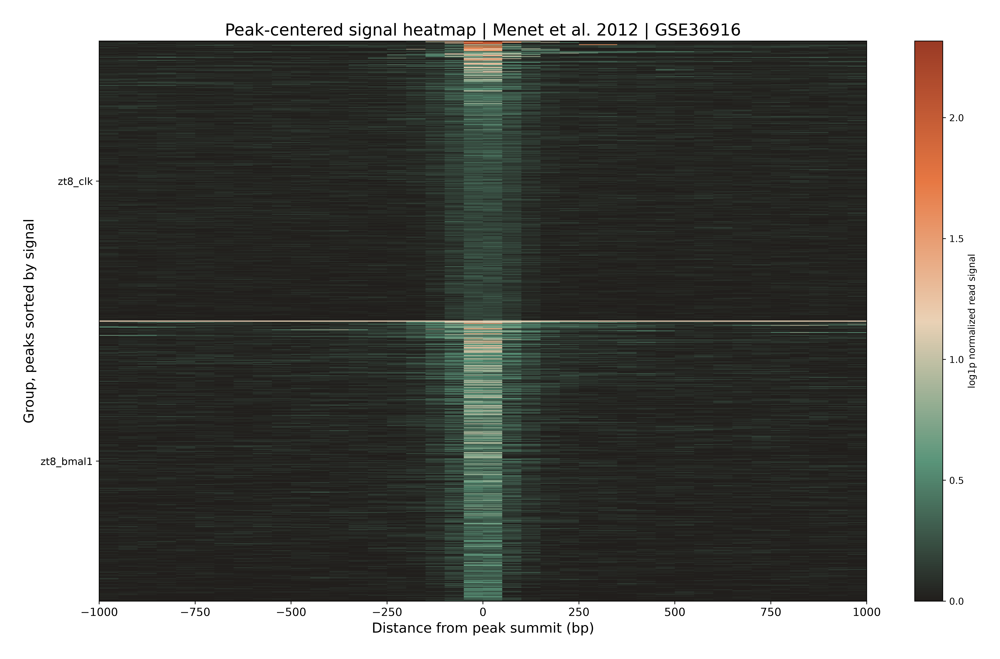
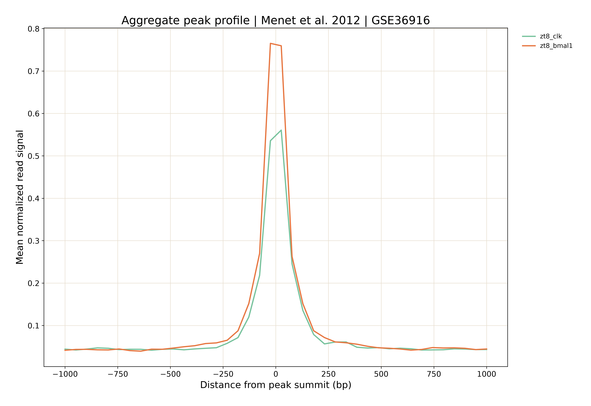
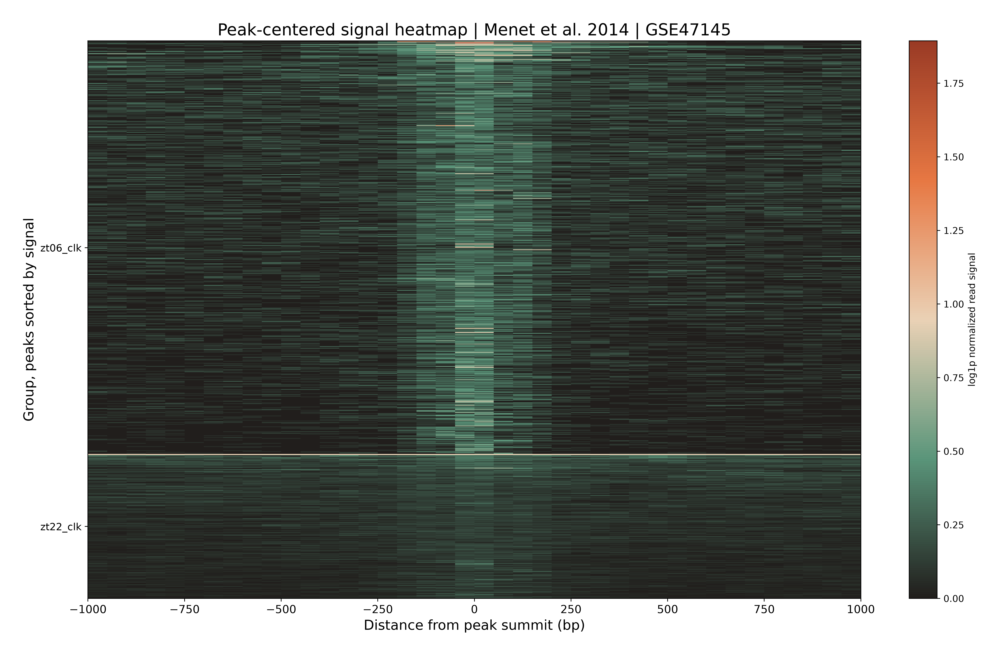
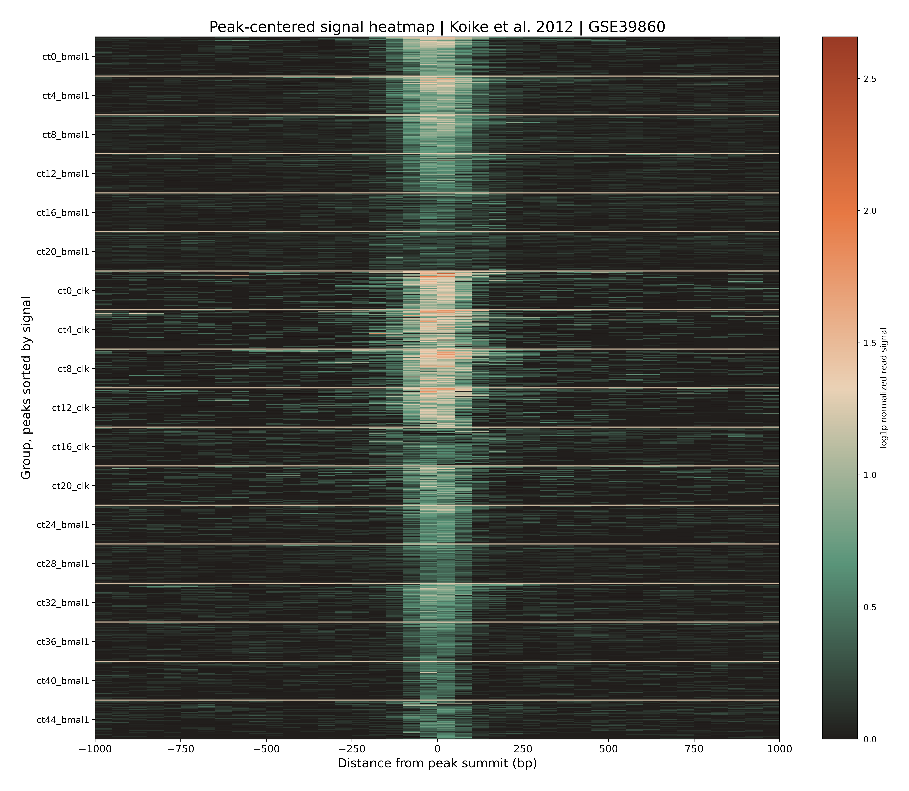
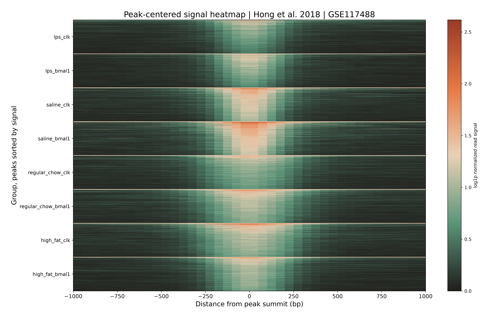
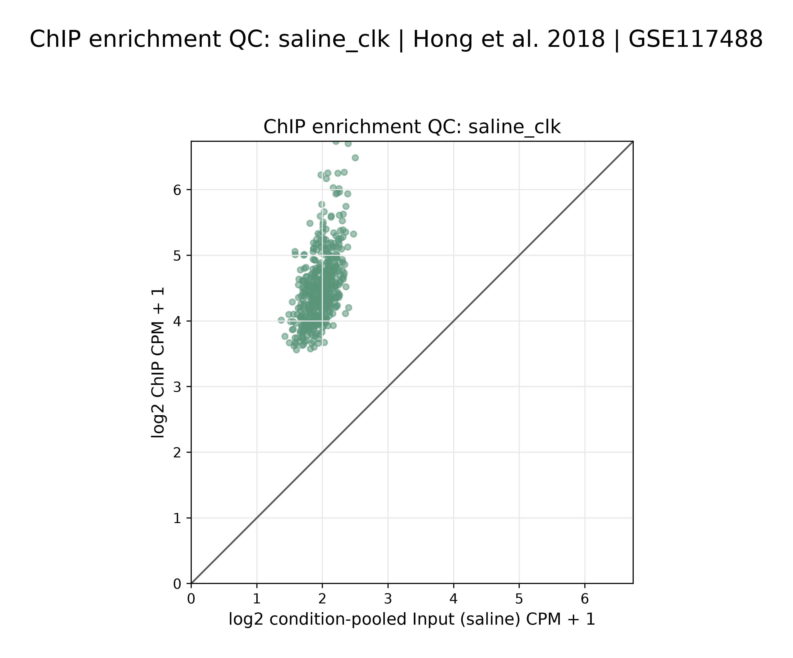

# 60% of the time, it works every time

*Is published research data ready to train your models on?*

I have been looking for circadian ChIP-seq data to fine-tune a gene language model for some research I have got going. There’s good news and bad news. The good news is that the data exists, the bad news is that much of it appears hard to reproduce. Why so? multiple reasons. In some instances there are decisions to be made which require partitioning the data according to circadian time points, while in other cases decisions made during processing and analysing the data does not appear to survive intact into the published methods.

Raw data thankfully exists and you can follow ENCODE project guidelines to process and analyse this data according to their standards (even if you are not using DNAnexus). That is where the second part of the challenges began. One thing is certain, while the papers describe real experiments and report biological findings. Those published findings are not the same thing as a fully specified route from raw reads to the exact set of peaks deposited with a study that you can go and validate.

This distinction matters more now that we can ask an agent to retrieve a paper, assemble a pipeline and process the reads. An agent can make the work faster, but it cannot recover a decision nobody recorded. The choice might live in a software version, a parameter not listed in Methods, a lab notebook, or correspondence that never became part of the public record. A convincing output does not tell us which of those decisions ultimately shaped what made it into the paper.

## A brief primer on circadian genes

*Clock* and *Arntl* (BMAL1) are canonical genes of the core molecular circadian clock. CLOCK and BMAL1 are also proteins that can associate with many regions across the genome. ChIP-seq uses antibodies against those proteins to enrich associated DNA. The signal generated from this method produces a called peak, which is an interval of enriched DNA and a candidate binding region, not another copy of the *Clock* or *Arntl* gene, a sequencing probe, or necessarily a promoter region. Assigning a peak to a promoter or gene requires a separate annotation rule.

I tackled this by going after the problem in three ways. First, I reconstructed the processing described in the publications where the available methods made that possible. Second, for two of the publications, I tested additional parameters and methodological choices supplied after requesting protocol information directly. That helped narrow things down but did not recover the published results in the tested reconstructions, all I can say is that there were ambiguities in the protocol that were impossible to confirm. I do not for a moment think that the results at one time may have been what was published but somewhere between the work and the manuscript those protocols changed.

Finally, I assembled an ENCODE-equivalent pipeline to enable reanalysis of the raw data, primarily motivated by the need to ensure that consistent processing and analysis was applied to all datasets. The papers used their own combinations of tools and rules, not ENCODE’s pipeline. The local implementation applies ENCODE’s gold-standard ChIP-seq approach to assess the data for reuse. It includes library and mapping checks, appropriate controls, peak calling and, where biological replicates exist, replicate-level assessment. It cannot create missing replicates or explain every difference with a paper.

<strong>Biological replicates</strong>Independent biological replicates support IDR comparison. Open the full diagram.
<figure class="process-map"><figcaption><a href="https://www.encodeproject.org/pipelines/ENCPL138KID/">Replicated transcription factor ChIP-seq pipeline</a>. Click to inspect the full diagram.</figcaption></figure>

<strong>No biological replicates</strong>IDR here uses pseudoreplicates, not independent biological replicates. Open the full diagram.
<figure class="process-map"><figcaption><a href="https://www.encodeproject.org/pipelines/ENCPL493SGC/">Unreplicated transcription factor ChIP-seq pipeline</a>. Its IDR output uses pseudoreplicates, not independent biological replicates. Click to inspect the full diagram.</figcaption></figure>

The comparison is not just about how many peaks a script prints. A deposited condition-specific peak set, a six-time-point master list, and a newly called per-condition set are different objects that aren’t directly comparable, and treating their totals as though they were interchangeable would manufacture a discrepancy. Where compatible coordinates exist, I can compare intervals. Where they do not, I say so.

## Surviving contact with reality

[Menet et al. (2012)](https://doi.org/10.7554/eLife.00011) report 759 sites associated with CLOCK and 1,579 with BMAL1 at ZT8 (or 8 hours after lights turn on). The deposited peak files used in my audit contain 759 CLOCK and 1,578 BMAL1 intervals. That one-interval difference between paper text and deposited file must be noted rather than silently rounded away, it might well be a typo but it is there nonetheless. An earlier audit I produced compared deposited coordinates with multiple tested reconstructions; none recovered both the deposited counts and the deposited peak sets. Extra methodological details did not close that gap. A few of the count differences show why a single number cannot stand in for the analysis:

| Menet 2012, ZT8 | CLOCK intervals | BMAL1 intervals | What is being counted |
|:--|--:|--:|:--|
| Paper text | 759 | 1,579 | Sites reported in the article |
| Deposited GEO files | 759 | 1,578 | Intervals in the supplied peak files |
| Published-method reconstruction | 174 | 607 | Soft-masked reconstruction in my earlier audit |
| One author-informed test | 123 | 237 | A tested sensitivity run, not the complete original protocol |
| Local ENCODE-equivalent, strict | 183 | 567 | Blacklist-filtered pooled calls at nominal p = 10⁻⁴, not the authors' pipeline |

These are counts from different methods, not a scorecard where the closest number wins. The published-method row comes from the earlier public audit; the last two come from the later local report on Dr Menet’s publication.The paper-versus-deposit BMAL1 difference of one interval is unresolved here. Count agreement would not establish that the same genomic intervals were recovered.

The experiment also lacks independent biological replicates for the comparison needed to establish replicate-level IDR. Multiple sequencing runs from one library do not solve that problem.

The heatmap I produced shows signal around selected called peaks in the independent audit, not a reproduction of the paper’s figure or proof that the paper’s deposited peak set was reconstructed.

[Menet et al. (2014)](https://doi.org/10.1101/gad.228255.113) report a 3,217-site all-site object. The available record does not specify enough about its construction to equate it with my separate ZT06 and ZT22 peak sets. The audit finds different levels of replicate support across those conditions. It does not claim to reproduce the published all-site object.

[Koike et al. (2012)](https://doi.org/10.1126/science.1226339) published a master list across time points. Its underlying workbook contains 4,636 CLOCK-associated and 5,952 BMAL1-associated peak intervals. My reanalysis calls peaks by time point, without relabelling their union as the authors’ master list. A separate analysis tests one reported 120 bp summit-matching rule, but it cannot recreate the unavailable historical software environment and every undocumented choice.

[Hong et al. (2018)](https://doi.org/10.1101/gad.319228.118) describe condition-specific CLOCK and BMAL1 analyses with biological replicates. In the saline CLOCK condition, the study report records 20,095 paper-reported peaks, compared with 21,100 strict pooled peaks in my reanalysis and 4,606 peaks in one biological-replicate IDR comparison. Those three counts refer to different selection rules; the IDR count is not a failed attempt to hit the published total. My local reanalysis can assess replicate consistency, but the corresponding published peak coordinates are unavailable for a direct coordinate-recovery claim. Count differences here are not evidence by themselves that the published biology was wrong. They also cannot be made to disappear by treating different conditions as one pool.

These are figures from my auditing effort, not figures from the original papers. A peak-centred heatmap shows signal at the peaks selected by the named audit track; it cannot independently establish that every selected peak is a true biological binding site. The QC scatter compares ChIP and Input signal, not the authors’ result with mine.

For the other papers, discrepancies remain unexplained. I did not contact their authors and I cannot turn an absence of correspondence into a claim about what their laboratories knew, or imply that every difference has the same cause, all I can claim is that the results cannot be reproduced directly from the published methods and when processed via ENCODE-equivalent methods, they produce different results.

## The useful stopping point

The reason for doing this is not to declare the papers bad. It is to decide whether the data can bear the claims we want to make with them by loading them into the model weights of a gene language model, to my knowledge, this is not something that existing models do before training or post-training. Under a consistent quality standard, some candidate results may not qualify as high-confidence inputs. Therefore, it is my opinion that keeping fewer examples can be the responsible approach here if the remaining evidence is more defensible.

Why write about this now? About a month after I finished this work, Prima Mente published its [Daedalus article](https://www.primamente.com/blog/prima-daedalus/), making the case for automating the route from published assays to evaluated datasets. I see the appeal. I also know how much can be missing between a paper and a result you can verify. Some unknown share of studies will not have enough surviving information for faithful reconstruction, however much compute you throw at them. Checking the evidence first tells us whether a full run is worth attempting. When the methods are well documented and the result can be checked, automation makes sense. When they are not, no amount of compute will solve that problem. I just don’t think we know how many studies meet that bar, and I would like that uncertainty to temper the claim that LLMs can solve every problem in biology.

As for what I will do with this? I will go ahead and use the model I have fine tuned as planned, I will just feel better knowing I could stand behind the claims I make using that model.

## References

- [Menet et al. (2012), *Nascent-Seq reveals novel features of mouse circadian transcriptional regulation*](https://doi.org/10.7554/eLife.00011).
- [Menet et al. (2014), *CLOCK:BMAL1 is a pioneer-like transcription factor*](https://doi.org/10.1101/gad.228255.113).
- [Koike et al. (2012), *Transcriptional architecture and chromatin landscape of the core circadian clock in mammals*](https://doi.org/10.1126/science.1226339).
- [Hong et al. (2018), *Requirement for NF-κB in maintenance of molecular and behavioral circadian rhythms in mice*](https://doi.org/10.1101/gad.319228.118).
- ENCODE: [transcription factor ChIP-seq pipeline with biological replicates](https://www.encodeproject.org/pipelines/ENCPL138KID/) and [unreplicated transcription factor ChIP-seq pipeline](https://www.encodeproject.org/pipelines/ENCPL493SGC/).
- [Landt et al. (2012), *ChIP-seq guidelines and practices of the ENCODE and modENCODE consortia*](https://doi.org/10.1371/journal.pcbi.1002691).
- [Prima Mente, *Automating training and ground truth data for BioAI models and evals*](https://www.primamente.com/blog/prima-daedalus/).
